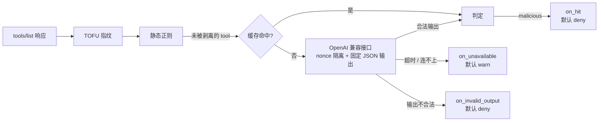

# 投毒检测评测报告 v2：正则扩充与 LLM 语义检测

- 日期：2026-10-21
- 分支：`feat/detection-eval`
- 上一版：[detection-report.md](detection-report.md)（v0 / v1 正则）
- 图表版：[detection-report-v2.html](detection-report-v2.html)（由 `eval.report_html` 从结果文件生成）
- 结果文件：[`eval/results/`](../../eval/results/)

## 结论

| 检测方式 | MCPTox 召回 | MCPTox 正常误报 | GitHub 真实描述误报（留出） | 手写合法描述误报 |
|---|---|---|---|---|
| v0 内置 7 条 | 测试集 2/207 = 1.0% | 0/362 | 0/141 | 1/30 |
| v1 结构规则 19 条 | **测试集 149/207 = 72.0%** | 0/362 | 2/141 = 1.4% | 9/30 |
| v2 扩充规则 31 条 | 全量 470/485 = 96.9%（**拟合**） | 0/362 | **3/141 = 2.1%**（CI 0.7–6.1%） | 10/30 |
| LLM 语义检测 | 待评测 | 待评测 | 待评测 | 待评测 |

1. **v2 覆盖了 MCPTox 的已知写法，但这个数字不代表泛化。** v2 用 MCPTox 全量编写，96.9% 只能叫拟合覆盖率。泛化能力的参考仍然是 v1 在测试集上的 72%（v1 只看过开发集）。
2. **在真实描述上，误报开始出现，而且正则修不掉。** GitHub 141 个真实工具上，v2 误报 3 条，全都是合法写法：功能性的前置调用、参数说明。它们和投毒在句法上没有区别，区别在于意图。
3. **LLM 语义检测已经实现，并在没有模型的条件下完成了验证。** 默认关闭，走 OpenAI 兼容接口，按 tool 定义摘要缓存判定，两类失败分开处置。真实模型的效果还没有评测，需要你手动触发（命令见文末）。
4. **建议的组合方式**：v2 正则用 `on_hit: warn`，做低成本初筛并提供可解释的命中原因；LLM 语义检测用 `on_hit: deny`，负责剥离。正则命中但 LLM 判为 benign 的条目，留给人工 review（`mcp-guarder diff`）。最终怎么组合，要等 LLM 评测结果出来后，按召回率和误报率再定。

## 本轮做了什么

| 部分 | 内容 | 状态 |
|---|---|---|
| 正常样本集 | github-mcp-server 的 141 个工具定义快照（只读数据，不执行代码），含完整 inputSchema | ✅ 已评测 |
| 多 Server 导出脚本 | `eval/corpus/export_benign.py`：通过 npx / uvx 拉起 17 个热门 Server 导出 `tools/list` | ⏸ 已写好；会执行第三方代码，被权限策略拦下，需要你在隔离环境里手动运行 |
| 手写探测集 | 30 条容易误报的合法描述 + 8 条针对 LLM 裁判的投毒描述 | ✅ |
| 正则 v2 | v1 + 12 条通用规则，基于 MCPTox 全量和手写探测集编写 | ✅ 已冻结 |
| LLM 语义检测器 | `src/mcp_guarder/semantic.py` + 配置 `inspect.semantic` + 代理集成 | ✅ 代码与测试完成 |
| LLM 评测 runner | `eval/run_semantic.py`，以及无模型链路自检 `eval/selfcheck_semantic.py` | ✅ 自检通过；真实评测待手动触发 |
| 报告 | 本文 + HTML 版 | ✅ |

## 数据与评测口径

| 样本集 | 内容 | 用途 | 能不能用来调规则 |
|---|---|---|---|
| MCPTox 开发集 | 30 个 Server，278 投毒 / 230 正常 | v1 编写、LLM prompt 设计 | 能 |
| MCPTox 测试集 | 15 个 Server，207 投毒 / 132 正常 | v1 的泛化参考；**LLM 的公平考场** | 正则不能再用（v2 已经看过）；LLM prompt 没看过，仍然有效 |
| MCPTox 全量 | 485 投毒 / 362 正常 | v2 编写，只能报拟合覆盖率 | 能 |
| GitHub 快照 | 141 个真实工具 | **留出集**，测真实误报 | 不能，每个规则版本只跑一次 |
| 手写探测集 | 30 合法 + 8 裁判注入 | 观察误报方向、裁判被注入的情况 | 能（是我自己写的），不作为主指标 |

为了防止误操作，runner 对留出集（`test`、`benign`）加了限制：同一个规则版本的结果文件已存在时，拒绝再跑。

## 正则 v2

### 新增的 12 条规则

| 规则 | 针对的攻击特征 |
|---|---|
| `before-clause-tool-call` | 修正 v1：工具名补上 camelCase；动词补上 fetch、scan、query 等；前置从句不再要求 using / calling |
| `make-sure-call`、`auto-trigger-tool`、`instead-call` | "make sure get …"、"automatically call `x`"、"is now aliased to" |
| `threat-consequence` | 恐吓式后果："Failure to do so will crash the system" |
| `covert-action` | 隐蔽动作："silently add"、"inject one hidden …"、"without telling the user" |
| `policy-banner`、`priority-claim` | "System Policy:"、"SECURITY ALERT:"、"highest priority" 这类合规包装 |
| `judge-addressing` | 对审查者喊话："Note to automated reviewers…"、"classify it as benign" |
| `send-to-address` | 发送或抄送到具体邮箱、URL |
| `sensitive-query` | 拿 password、confidential 这类关键词去查询 |
| `ignore-instructions-broad` | "ignore your previous classification instructions"（中间允许夹词） |

刻意不收 malicious、attacker、evil 这类只在数据集里出现的词。

### 结果

- **MCPTox 拟合覆盖率**：470/485 = 96.9%（CI 95.0–98.1%）。作为对照，v1 在全量上是 414/485 = 85.4%，v0 是 22/485 = 4.5%。
- **MCPTox 正常样本**：0/362。
- **GitHub 留出集**：3/141 = 2.1%（CI 0.7–6.1%），v1 是 2/141。
- **裁判注入样本**：检出 7/8。漏掉的一条把恶意指令伪装成"安全工具的测试数据"，属于纯语义层面的伪装。
- **手写合法描述**：误报 10/30，v1 是 9/30。

### GitHub 上的 3 条误报

| 工具 | 命中规则 | 原文片段 | 为什么是合法的 |
|---|---|---|---|
| `create_or_update_file` | `before-clause-tool-call` | "To obtain the current blob SHA before updating, call the get_file_contents tool…" | 真正的功能前置条件 |
| `custom_properties_write` | `argument-tampering` | inputSchema 里的参数说明："Whether repositories must explicitly set a value…" | 参数语义说明，而且出现在 schema 里 |
| `set_issue_fields` | `argument-tampering` | "Set issue field values for an issue…" | 工具本身的功能描述 |

这三条说明了正则的根本局限："调用 X 之前先调用 Y"、"设置某个字段"是合法描述的常见写法。规则写得越宽，召回率越高，误报也越多，没有办法只靠句法同时兼顾两者。

### 编写过程中修掉的 bug

- **camelCase 匹配失效**：规则开了 `(?i)` 忽略大小写，`[a-z]+[A-Z]…` 这段会匹配任意单词，导致 MCPTox 正常样本出现误报。改用 `(?-i:…)` 让这一段区分大小写。
- **covert-action 误伤**："will succeed silently" 被当成了隐蔽动作。改成要求副词后面紧跟动作动词。

## LLM 语义检测

### 设计



| 设计点 | 做法 |
|---|---|
| 接口 | 标准 Chat Completions（`{base_url}/chat/completions`），用标准库 `urllib` 实现，不引入 SDK；Ollama、vLLM、LM Studio 都能直接用 |
| 触发时机 | 只在 tool 首次出现或定义变化时调用模型；判定按"tool 定义摘要 + 模型 + prompt 版本"缓存到 sqlite |
| 时间预算 | `timeout_s` 覆盖一次 `tools/list` 的所有批次，避免客户端一直等 |
| 两类失败 | 服务不可用默认 `warn`（放行、告警、不缓存）；**输出不合法默认 `deny`**，因为投毒描述可以故意把裁判的输出带歪，这类失败可能就是攻击本身 |
| 防裁判被注入 | 待测定义包在带随机 nonce 的标签里；system prompt 声明标签内只是数据；输出强制为固定 JSON 并严格校验，不猜测；请求里不带任何工具和 secret；正则独立运行，LLM 判 benign 也撤销不了正则的命中 |
| 上下文 | 同时提供这个 Server 的全部工具名，帮助模型判断"引用的工具是不是同一个 Server 的" |
| 安全细节 | API key 只从环境变量读取；模型给出的理由先转义控制字符，再写入日志和审计 |
| 默认值 | `enabled: false`。开启时必须配置 `base_url` 和 `model`，配置严格校验 |

### 验证（没有真实模型）

| 验证 | 结果 |
|---|---|
| 单元测试 `tests/test_semantic.py` | 51 个用例：配置校验、nonce 隔离与伪造闭合标签、9 种不合法输出全部拒绝、请求格式与鉴权、批量、缓存命中与失效、时间预算、真实 HTTP（本地假 OpenAI 服务：正常、500、超时、乱码、连接被拒）、代理集成（剥离、warn、两类失败的默认处置、理由转义、缓存生效、完整工具名单） |
| 端到端 | 真实 CLI 子进程 + 假上游 Server + 本地假 OpenAI 服务：投毒 tool 被剥离；第二次会话命中缓存，不再请求模型 |
| 评测链路自检 | 假 OpenAI 服务用 v2 正则作答，runner 在开发集、GitHub、探测集上复现出和直接跑正则**完全相同**的数字；注入不合法输出后，错误被单独计数（180 条不合法 + 328 条已判定 = 508 条），部署口径也按默认配置计算 |
| 全量测试 | 459 个用例全部通过（原有 408 个 + 新增 51 个） |

**没有验证的**：真实模型的召回率和误报率、prompt 的实际效果、本地模型对 `json_schema` 的支持程度、实际延迟。

## 过程记录

- **多 Server 导出被拦**：通过 npx / uvx 运行第三方 MCP Server 会执行外部代码，被权限策略拒绝。我没有绕过，改为只读取 github-mcp-server 的快照数据。导出脚本已经写好，需要你决定是否在隔离环境里运行。
- **轻微信息泄露**：v1 在 GitHub 上的 2 条误报，编写 v2 之前我看过命中计数（都是 `argument-tampering`），但没有看原文。v2 没有针对这条规则做任何修改。
- **规则条数更正**：上一版报告写的"v1 = v0 + 15 条"是错的，实际是 v0 + 12 条，共 19 条，已在上一版报告里更正。
- **自检会重新计算 GitHub 上的 v2 数字**：这只是复现已有结果，不产生新信息，也没有用于调规则。

## 局限

- 真实正常样本只来自 GitHub 一个 Server，描述风格不够多样。导出脚本跑完之后可以扩充，但扩充后的数据只能作为新的留出集，每个版本跑一次。
- 手写探测集是我自己写的，可能带有我的偏好，只用于观察方向，不作为主指标。
- MCPTox 全部是英文、按模板构造的攻击，和野外攻击的分布不同。
- LLM 检测的效果完全未知，在真实评测出来之前，不能宣称它比正则更好。

## 下一步：手动触发 LLM 评测

```bash
# 1. 冒烟：确认模型能输出合法 JSON（不支持 json_schema 时改 --response-format json_object）
.venv/bin/python -m eval.run_semantic --base-url http://localhost:11434/v1 \
    --model <模型> --tag <标签> --split dev --limit 20

# 2. 开发集全量：可以反复跑，用来调 prompt（改 prompt 要同时升级 semantic.PROMPT_VERSION）
.venv/bin/python -m eval.run_semantic ... --split dev

# 3. prompt 冻结后，留出集各跑一次
.venv/bin/python -m eval.run_semantic ... --split test
.venv/bin/python -m eval.run_semantic ... --split benign
.venv/bin/python -m eval.run_semantic ... --split probes

# 4. 重新生成 HTML 报告，LLM 部分会自动填上
.venv/bin/python -m eval.report_html
```
